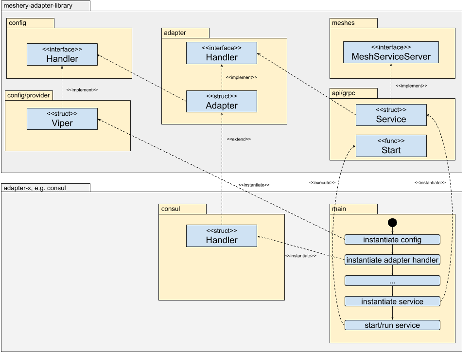
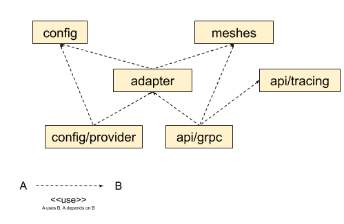

# Meshery Adapter Library
The Meshery Adapter Library provides a common and consistent set of functionality that Meshery adapters use for managing the lifecycle, configuration, operation, and performance of cloud native infrastructure. See [What are Meshery Adapters?](https://docs.meshery.io/concepts/architecture/adapters/) for more.

## Purpose 

The main purpose of the meshery-adapter-library is to 
* provide a set of interfaces, some with default implementations, to be used and extended by adapters.
* implement common cross cutting concerns like logging, errors, and tracing
* provide a mini framework implementing the gRPC server that allows plugging in the mesh specific configuration and 
    operations implemented in the adapters.

### Overview and usage 

The library consists of interfaces and default implementations for the main and common functionality of an adapter. 
It also provides a mini-framework that runs the gRPC adapter service, calling the functions of handlers injected by the 
adapter code. This is represented in an UML-ish style in the figure below. The library is used in the Consul adapter, 
and others will follow. 



### MeshModel component generation and registration

The adapter package provides modern MeshModel generation and
registration APIs alongside the existing legacy APIs.

#### Component generation

| API | Purpose |
| --- | --- |
| `GenerateNativeComponent` | Generate a component definition from a CRD. |
| `GenerateNativeComponentWithModel` | Generate a component with model information and styles. |
| `CreateModernComponents` | Generate component files from a configured source. |
| `CreateModernComponentsFromSources` | Generate component files from multiple sources as one batch. |

Example:

```go
definition, err := adapter.GenerateNativeComponentWithModel(
    crd,
    modelName,
    releaseVersion,
    adapter.MeshModelConfig{
        Category: "Cloud Native Network",
    },
)
if err != nil {
    return err
}
```

The file generation APIs use `StaticCompConfig` to configure
sources, destinations, model metadata, release directories
and overwrite behavior.

Manifest and Helm chart sources are supported.

For multi-version CRDs, generation prefers a served storage
version and otherwise selects the first served version.
The selected version determines component API identity and schema.
Legacy Kubernetes v1beta1 CRDs may use a shared OpenAPI schema
under spec.validation. Modern v1 CRDs require a version-specific
OpenAPI schema.

Existing component filename conventions are preserved.
Filename collisions are detected before writing generated files.
Collision errors identify both component kinds, API versions
and positions in the combined resource batch.

With `Force` disabled, existing files are preserved.
Core component recovery excludes the target release directory
when selecting the latest eligible source directory.
Source selection does not independently verify directory
completeness or that its release precedes the target.

Generation is not transactional. An unsuccessful operation
may leave a partially populated destination directory.

#### Modern component registration

Use `RegisterModernMeshModelComponents` to discover and register
component files from the configured `MeshmodelComponents` directory.

Use `RegisterModernMeshModelComponentFiles` to register an
explicit list of component definition files.

```go
ctx, cancel := context.WithTimeout(
    context.Background(),
    2*time.Minute,
)
defer cancel()

err := adapter.RegisterModernMeshModelComponentFiles(
    ctx,
    instanceID,
    mesheryServerAddress,
    adapterHost,
    adapterPort,
    componentPaths,
)
if err != nil {
    return err
}
```

The examples assume imports for the adapter package and,
where applicable, the standard context and time packages.

The server address must include an HTTP or HTTPS scheme.
The adapter port is a string representing a port from 1 to 65535.

Modern registration uses `POST /api/registry/components`.

For lower-level control, `ModernComponentRegistrant` accepts
an explicit endpoint, serialized connection information
and an optional HTTP client. Its `RegisterFiles` method
accepts a context and component definition paths.

Automatic discovery includes only regular files ending
with `_meshmodel.json`. Documentation, placeholder files,
unrelated JSON files and symbolic links are excluded.

Explicit file registration does not apply this discovery filter.

Modern registration accepts modern component definitions
and migrates supported legacy definitions before submission.

Legacy definitions with omitted or empty formats are treated
as JSON when their schemas contain valid JSON.
Explicit unsupported formats and invalid JSON are rejected.

These checks do not constitute full schema conformance validation.

#### Legacy registration compatibility

The existing `RegisterMeshModelComponents` and
`MeshModelRegistrant.Register` APIs remain available.

For caller-controlled cancellation, use
`RegisterMeshModelComponentsWithContext` or
`MeshModelRegistrant.RegisterWithContext`.

Legacy registration retains its existing payload structure
and the `POST /api/meshmodel/components/register` endpoint.

The original APIs use a background context. Applications
requiring caller-controlled deadlines should use the
context-aware variants.

#### Registration timeout and retry behavior

Both registration paths use a shared HTTP client implementation.

- Each HTTP attempt has a 30-second context deadline,
  subject to an earlier caller deadline.
- HTTP 200, 201 and 202 responses are treated as acknowledgements.
  A subsequent response-body read failure does not invalidate the
  acknowledgement or trigger another registration attempt.
- Request-construction errors are permanent failures.
- HTTP 4xx responses other than 408 and 429 are permanent failures.
- Other unsuccessful HTTP responses and transport failures
  are eligible for exponential-backoff retries.
- The backoff elapsed-time limit is ten minutes per component.
  It is not a strict overall batch deadline.
- Error response excerpts are limited to 4096 bytes.
- Caller cancellation stops context-aware HTTP operations
  and retry waits.

Registration errors may contain server response excerpts.
Applications should consider this when logging errors.

#### Partial registration outcomes

Modern registration processes files sequentially and stops
at the first unrecoverable error.

Use the standard errors package to inspect partial outcomes:

```go
var partial *adapter.PartialRegistrationError

if errors.As(err, &partial) {
    // partial.Acknowledged: files receiving successful HTTP responses.
    // partial.Failed: file at which processing stopped.
    // partial.Unattempted: remaining files not processed.
    // partial.Err: underlying error.
}
```

The failed file may not have reached HTTP submission,
for example when cancellation or file validation fails.

The underlying error is available through Go error unwrapping.

Partial registration outcomes are provided by the modern
registration path. Initial argument validation errors
may be returned directly without a partial result.

#### Registration consistency and idempotency

A successful HTTP response is an acknowledgement,
not independent verification of database persistence.

A failed or timed-out request may already have been processed
by the server. Repeated registration and retries after
ambiguous failures may create duplicate registry entries.

Do not assume that replaying a registration batch or retrying
its failed file is safe. Reconcile registry state before replay.

End-to-end registration idempotency and the final component
schema version contract require coordination with registry
and schema maintainers.

These APIs do not guarantee exactly-once registration
or compatibility with every Meshery server release.

### Package dependencies hierarchy
A clear picture of dependencies between packages in a module helps avoid circular dependencies (import cycles), 
understand where to put code, design coherent packages etc.

Referring to the figure below, the packages `config` and `meshes` (which contains the adapter service proto definition) 
are at the top of the dependency hierarchy and can be used by any other package. Thinking in layers (L), `config`  
would be in the top layer, L1, `adapter` in L2, and `config/provider`  in L3. Packages can always be imported and used in lower layers.



<div>&nbsp;</div>

## Join the  community!

<a name="contributing"></a><a name="community"></a>
Our projects are community-built and welcome collaboration. 👍 Be sure to see the <a href="https://docs..io/project/contributing#not-sure-where-to-start">Contributor Welcome Guide</a> for a tour of resources available to you and jump into our <a href="http://slack.meshery.io">Slack</a>!
<p style="clear:both;">

<h3>Find your MeshMate</h3>

<p>MeshMates are experienced community members, who will help you learn your way around, discover live projects and expand your community network. 
Become a <b>Meshtee</b> today!</p>

Find out more on the <a href="https://meshery.io/community#meshmates">Meshery community</a>. <br />
<br /><br /><br /><br />
</p>

<div>&nbsp;</div>

<a href="https://meshery.io/community"></a>

<a href="http://slack.meshery.io"></a>

<p>
✔️ <em><strong>Join</strong></em> any or all of the weekly meetings on <a href="https://meshery.io/calendar">community calendar</a>.<br />
✔️ <em><strong>Watch</strong></em> community <a href="https://www.youtube.com/@mesheryio?sub_confirmation=1">meeting recordings</a>.<br />
✔️ <em><strong>Fill-in</strong></em> a <a href="https://meshery.io/newcomers">community member form</a> to gain access to community resources.
<br />
✔️ <em><strong>Discuss</strong></em> in the <a href="https://meshery.io/community#discussion-forums">Community Forum</a>.<br />
✔️ <em><strong>Explore more</strong></em> in the <a href="https://meshery.io/community#handbook">Community Handbook</a>.<br />
</p>
<p align="center">
<i>Not sure where to start?</i> Grab an open issue with the <a href="https://github.com/issues?q=is%3Aopen%20is%3Aissue%20archived%3Afalse%20(org%3Ameshery%20OR%20org%3Ameshery-extensions)%20label%3A%22help%20wanted%22%20">help-wanted label</a>.
</p>
